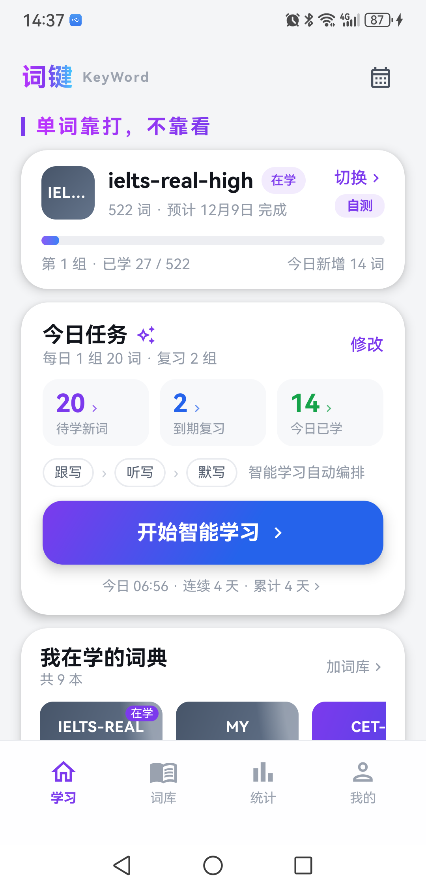
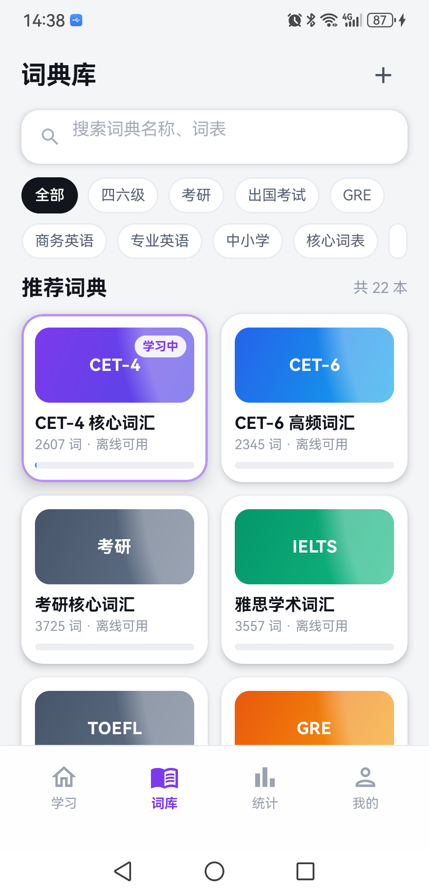
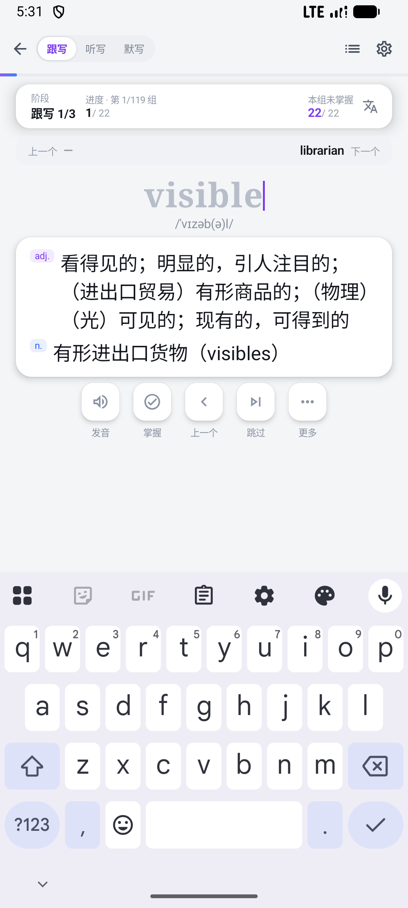
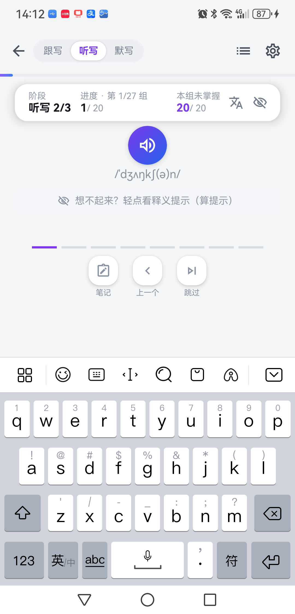
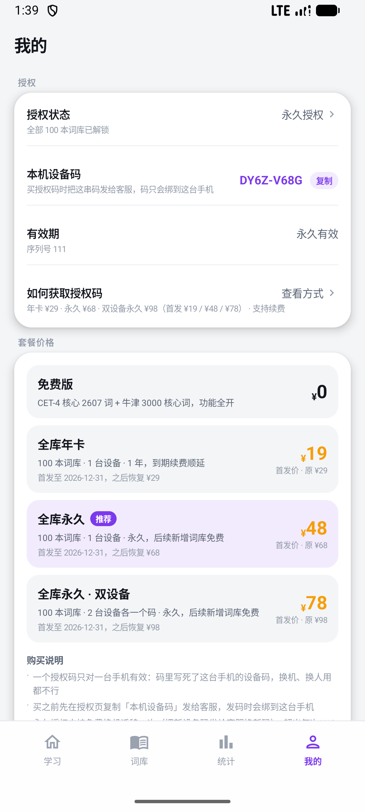

# 词键 KeyWord

> 单词靠打，不靠看。

一个**完全离线**的 Android 单词练习 App：不给你"看单词点认识"的机会，只让你**用键盘把单词一个字一个字打出来**，靠手上的肌肉记忆把拼写记住。

内置 100 本词库，跟写 / 听写 / 默写三阶段练习，发音、释义、例句、记忆曲线排程、收藏与错词本、自建词典全部在本机完成。不联网、不上传、不需要注册账号，所有数据只留在手机上。

-3DDC84?logo=android&logoColor=white)


---

## 下载与版本

| 项 | 值 |
|---|---|
| 安装包 | [`KeyWord-1.0.apk`](KeyWord-1.0.apk) |
| 版本 | 1.0（versionCode 1） |
| 发布日期 | 2026-11-12 |
| 文件大小 | 92,458,898 字节（88.2 MiB） |
| 支持系统 | Android 8.0 及以上（API 26+） |
| 签名 | debug（调试）签名，可直接侧载安装 |
| SHA-256 | `0752B4197B29EFEB9C5787EDB5653DE11E72EF1E05AABCBC9D7ECB197782E851` |

校验安装包是否完整（可选）：

```powershell
Get-FileHash .\KeyWord-1.0.apk -Algorithm SHA256
```

> 本包使用调试（debug）签名，可以直接侧载安装；若将来要上架应用商店，需要另配发布签名重新打包。

---

## 界面

| 首页 · 今日任务 | 词库 · 100 本 |
|---|---|
|  |  |

| 跟写 · 逐字母输入 | 听写 · 只听发音 |
|---|---|
|  |  |

**我的 · 授权与设备码**（购买前在这里复制本机设备码发给客服）



---

## 为什么做这个

主流背单词 App 的交互是「看单词 + 点认识 / 不认识」，结果是**认得出但写不出**。真正需要拼写的场合——考试填空、作文、写邮件——靠的是肌肉记忆，而肌肉记忆只能靠键盘一遍遍敲出来。

所以这个 App 只做一件事：给你一个词、一段发音、一句例句，然后**让你把它完整打出来**。敲错了就重来，直到这个词的手指路径变成本能。

---

## 功能说明

### 一、三阶段练习

每个词都要走完「跟写 → 听写 → 默写」，难度逐级加码：

- **跟写**：单词和音标显示在页面最上方，逐字母输入，已输入的字母实时变绿，敲错整词重来
- **听写**：只播发音，看不到拼写，把词打出来；页面按「听 → 看音标 → 填字母」排布，看不懂时可轻点提示条查看释义（会记为一次提示）
- **默写**：只给中文释义，把英文拼出来
- **自测**：一组词快速过一遍，答错的自动进入薄弱项，之后回炉
- **今日任务**：每天新词 N 个 + 到期复习 M 组，按记忆曲线自动编排，不用自己记账；首页「修改」可调整每日新词数与复习组数，词典详情页可选起始词
- 键盘全程常驻；敲对字母有轻声读音、敲错有「嘟嘟」提示音（都可在设置里关掉）

### 二、词库

- **100 本词库全部内置、全部离线**：四六级、考研、雅思、托福、GRE、专四专八、PETS、商务英语、中小学、核心词表等
- 精选词库带**例句、词源、词频星级、记忆曲线信息**，其余为纯词表
- 词库页支持搜索与分类筛选，按「四六级 / 考研 / 出国考试 / GRE / 商务英语 / 专业英语 / 中小学 / 核心词表」分类
- 词典详情页显示已学 / 掌握 / 剩余、进度条与完整词表，可直接切换为「正在学习」或进入自测
- 首页「我在学的词典」展示所有在学词典的进度，点一下就换着学
- **自建词典**：手工录入单词（填词、音标、释义即可），可逐词删除，也可整本删除（删除前二次确认），和内置词库一样参与练习

### 三、词本

- **收藏的单词**：练习中点「收藏」的词，单独成册，可查看、可单独练
- **未掌握的词**：练习里打错、还没掌握的词自动归集，单独入口专门练薄弱项
- 两个入口都在首页「我的词本」卡片里，显示实时词数

### 四、发音

- 单词发音优先播放内置离线音频，缺失时自动改用系统 TTS，不依赖网络
- 例句朗读走系统 TTS
- 设置项「自动朗读第一句」：进入单词时自动播放例句
- 设置项「发音后朗读释义」：读完英文单词接着念中文释义，**默认关闭**，且**只在跟写阶段生效**——听写 / 默写阶段绝不念中文，否则等于把答案念出来

### 五、学习统计

学习概览（连续打卡天数）、本周学习柱状图、今日已学词数与学习时长、当前词典掌握情况（总词 / 已学 / 剩余）。统计入口在底部「统计」页，也可从「我的 → 学习统计」进入。

### 六、设置项

- 练习行为：显示上一个 / 下一个单词、输错后清空输入、输入字母时发音、输错提示音、自测题量（10 / 20 / 30）、单词重复次数（1 / 2 / 3 / 5 / 自定义）、每天最多复习组数、无到期词时随机复习
- 内容与例句：显示词源与相关词、总是显示笔记、练习例句、自动朗读第一句、发音后朗读释义
- 字号：英文单词字号、中文释义字号可分别滑动调节

---

## 安装

1. 下载 `KeyWord-1.0.apk` 传到手机（微信/QQ 传输、数据线拷入、或直接在手机浏览器下载）
2. 点击安装包，系统提示"未知来源"时允许「安装未知应用」
3. 安装完成，桌面出现「词键」图标

覆盖升级：直接安装新包即可，学习进度与授权会保留（**不要先卸载**）。

第一次启动若提示缺少语音引擎，请在「设置 → 无障碍/语言 → 文字转语音输出」里选择并下载一个中文+英文语音包（多数国产机型已自带）。

---

## 授权与免费范围

免费版**功能不阉割**，只在词库范围上受限：

- 免费可用：**CET-4 核心词汇**、**牛津 3000 核心词**
- 其余词库需授权后解锁

授权采用**离线授权码**，格式 `KW-XXXXXXXX-XXXXXXXX-XXXXXXXX-XXXXXXXX`（32 个字符，4 段）：

- 码内自带到期日并用签名防伪，改一位即失效，不需要联网校验
- **一个码只对一台手机有效**：设备码（本机的设备指纹）直接写死在码里，同一枚码换到第二台手机激活会被拒绝，并提示这枚码绑定的是哪台设备
- 激活与续费是同一个入口：只接受「到期日比当前更晚」的码，提前续费会自动往后顺延
- 卸载重装**不影响**：设备码不变，把授权码重新输一次即可恢复付费词库

**买码前先复制本机设备码**：打开「我的 → 授权」，授权卡片里的「本机设备码」（形如 `7RDY-8GHN`）右侧有「复制」按钮，把这串码发给客服，发码时会绑定到这台手机。

换手机：永久授权支持**免费换机迁移 1 次**（把新手机的设备码发过去换新码），超出每次 ¥10。

> 获取授权码：App 内「我的 → 授权 → 查看方式」，也可加微信 **dudu2650917**（备注「词键」）。

---

## 常见问题

**Q：点了「发音」没有声音？**
1. 先调高媒体音量（按音量键出现的是"媒体"滑块，不是铃声）；
2. 如果后台有音乐/听书类 App 正在播放，它会占住媒体通道，把本 App 的发音压得很低——先暂停后台播放再试；
3. 仍无声，检查系统「文字转语音输出」是否选择了可用的语音引擎，并确认已下载英文语音包。

**Q：换了词典，点「继续学习」没反应？**
这是旧版本的已知问题（切换词库后加载状态未复位），本版本已修复；点一下会等词库解析完自动进入。

**Q：换了手机，原来的授权码还能用吗？**
不能直接用在第二台手机上——每个码只认一台设备的设备码。永久授权可以免费迁移 1 次：在新手机上打开「我的 → 授权」，复制「本机设备码」发给客服，换一枚绑定新设备的码。之后再迁移每次 ¥10。

**Q：卸载重装后还要重新买吗？**
不用。同一台手机卸载重装后设备码不变（可在「我的 → 授权」里核对），把原来那枚授权码重新输一次即可恢复。学习进度只存在本机，卸载会清空，需要重新学。

**Q：学习进度能同步到新手机吗？**
不能。所有数据（进度、收藏、词本、统计）只存在本机，换机或卸载后清空，需要重新学、重新输授权码。这是"完全不联网"的代价。

**Q：可以导入 Excel / TXT 词表吗？**
当前只支持在 App 内手工录入单词。批量导入尚未提供。

**Q：能改词库顺序或自己打乱吗？**
暂不支持，词库顺序按内置词表固定。

---

## 已知限制

- 学习进度仅存本机，无云同步；卸载 / 换机需重输授权码
- 自建词典只支持手工录词，没有批量导入
- 词库为词表整理，不含教材课文与配套音频
- 词库中部分词条以纯词表形式提供，例句与词源只覆盖精选词库
- 少数词库的词性字段缺失，释义前不显示 `n.` / `v.` 之类标记（不影响练习）

---

## 声明

个人学习作品。词表数据整理自公开词表资源，仅用于本地学习使用；App 不收集、不上传任何用户数据，没有账号、没有埋点、没有联网权限需求。

如果这个思路对你有用，欢迎 Star 或提 Issue。
